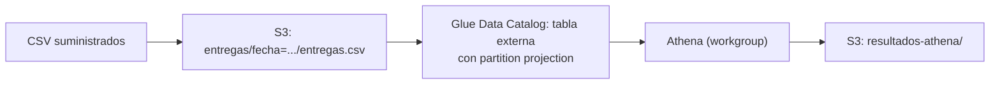

# Examen final — Entregas con partition projection (S3 + Glue + Athena + Terraform)

> Este repositorio contiene los dos puntos del examen final: **Punto 1** (esta raíz: S3 + Glue + Athena con Terraform) y **Punto 2** en [`punto2_ventas/`](punto2_ventas/) (dbt source freshness + Airflow).

Una empresa de mensajería sube un CSV diario con los intentos de entrega. Los archivos quedan en S3 bajo
`entregas/fecha=yyyy-MM-dd/`, una tabla externa de Glue Data Catalog con **partition projection** describe su esquema
y sus ubicaciones, y Athena los consulta y escribe sus resultados en `resultados-athena/` del mismo bucket.
El enunciado original está en [ENUNCIADO.md](ENUNCIADO.md).



## Prerrequisitos

- Cuenta de AWS y usuario IAM con permisos sobre S3, Glue y Athena (en este ejercicio, el perfil de AWS CLI configurado con `aws configure`).
- AWS CLI v2, Terraform >= 1.5 y Bash (WSL2/Ubuntu en Windows).
- **Región:** `us-east-1` (variable `region` en `infraestructura/variables.tf`).

Comprobar la identidad antes de empezar:

```bash
aws sts get-caller-identity          # si usas un perfil con nombre: export AWS_PROFILE=<perfil>
terraform -version
```

## Estructura

| Ruta | Contenido |
| --- | --- |
| `infraestructura/principal.tf` | Proveedor, bucket privado con bloqueo de acceso público y cifrado, base de datos y tabla de Glue con partition projection, workgroup de Athena |
| `infraestructura/variables.tf` | Región, prefijo del bucket, nombres de base de datos, tabla y workgroup, rango proyectado |
| `infraestructura/salidas.tf` | Bucket, rutas, base de datos, tabla y workgroup |
| `consultas/` | SQL de las tres consultas y de la verificación del tercer día |
| `scripts/ejecutar_consulta.sh` | Ejecuta una sentencia en el workgroup con AWS CLI, descarga el resultado y registra la ejecución en `evidencias/ejecuciones_athena.csv` |
| `scripts/comparar.sh` | Compara un resultado con su referencia de `resultados_esperados/` |
| `resultados/inicial/`, `resultados/final/` | Resultados obtenidos en Athena por etapa |
| `evidencias/` | Aplicación de Terraform, outputs, ejecuciones de Athena y eliminación |
| `respuestas.md` | Preguntas conceptuales |

## Diseño de la tabla

- Columnas en el orden del archivo: `id_envio string`, `ciudad string`, `transportadora string`, `estado string`, `duracion_minutos int`.
- `LazySimpleSerDe` con `field.delim = ","` y `skip.header.line.count = 1` para omitir el encabezado de cada archivo.
- `fecha` es **clave de partición** de tipo `string`, separada de las columnas (no existe dentro del CSV).
- Partition projection: `projection.enabled = true`, `projection.fecha.type = date`, `format = yyyy-MM-dd`,
  `range = 2026-10-01,2026-10-03`, `interval = 1`, `interval.unit = DAYS` y
  `storage.location.template = s3://<bucket>/entregas/fecha=${fecha}/` (prefijo de la partición, terminado en `/`;
  el archivo `entregas.csv` está dentro de ese prefijo).
- No se crean particiones individuales con Terraform ni con ningún otro mecanismo.

## 1. Despliegue

```bash
cd infraestructura
terraform init
terraform fmt -check && terraform validate
terraform plan
terraform apply -auto-approve -no-color | tee ../evidencias/aplicacion_terraform.txt
terraform output -json > ../evidencias/outputs.json
cd ..
BUCKET=$(terraform -chdir=infraestructura output -raw bucket_s3); echo "$BUCKET"
```

## 2. Demostración inicial: días 1 y 2

Se cargan **solo** dos archivos, uno por uno (sin subir la carpeta de forma recursiva):

```bash
aws s3 cp "data/entregas/fecha=2026-10-01/entregas.csv" "s3://$BUCKET/entregas/fecha=2026-10-01/entregas.csv"
aws s3 cp "data/entregas/fecha=2026-10-02/entregas.csv" "s3://$BUCKET/entregas/fecha=2026-10-02/entregas.csv"
aws s3 ls "s3://$BUCKET/entregas/" --recursive
```

El rango proyectado ya incluye el 2026-10-03, pero ese archivo todavía no existe en S3: la proyección no crea datos.

Consultas de la etapa inicial (cada ejecución queda en `evidencias/ejecuciones_athena.csv`):

```bash
bash scripts/ejecutar_consulta.sh inicial consultas/verificacion_tercer_dia.sql resultados/inicial/total_registros.csv 2   # 12 registros
bash scripts/ejecutar_consulta.sh inicial consultas/intentos_por_fecha_estado.sql resultados/inicial/intentos_por_fecha_estado.csv
bash scripts/ejecutar_consulta.sh inicial consultas/porcentaje_exito_por_fecha_ciudad.sql resultados/inicial/porcentaje_exito_por_fecha_ciudad.csv
bash scripts/ejecutar_consulta.sh inicial consultas/duracion_promedio_2026-10-02.sql resultados/inicial/duracion_promedio_2026-10-02.csv

bash scripts/comparar.sh resultados/inicial/intentos_por_fecha_estado.csv resultados_esperados/intentos_por_fecha_estado_inicial.csv
bash scripts/comparar.sh resultados/inicial/porcentaje_exito_por_fecha_ciudad.csv resultados_esperados/porcentaje_exito_por_fecha_ciudad_inicial.csv
bash scripts/comparar.sh resultados/inicial/duracion_promedio_2026-10-02.csv resultados_esperados/duracion_promedio_2026-10-02.csv
```

Las consultas de intentos y porcentaje filtran todo el rango del ejercicio (`2026-10-01` a `2026-10-03`), así que en la
etapa inicial solo devuelven los días cargados (6 y 4 filas) y en la final incluyen el tercer día sin cambiar el SQL.

## 3. Nueva fecha: día 3 (sin tocar la infraestructura)

La incorporación consiste **únicamente en subir el archivo y consultar**. No se ejecutan crawlers, `MSCK REPAIR TABLE`,
`ALTER TABLE ADD PARTITION`, ni cambios en Terraform o en las propiedades de la tabla.

```bash
aws s3 cp "data/entregas/fecha=2026-10-03/entregas.csv" "s3://$BUCKET/entregas/fecha=2026-10-03/entregas.csv"

bash scripts/ejecutar_consulta.sh final consultas/verificacion_tercer_dia.sql resultados/final/verificacion_tercer_dia.csv 1      # 6 registros del 2026-10-03
bash scripts/ejecutar_consulta.sh final consultas/verificacion_tercer_dia.sql resultados/final/total_registros.csv 2              # 18
bash scripts/ejecutar_consulta.sh final consultas/verificacion_tercer_dia.sql resultados/final/registros_por_fecha.csv 3          # 6 por fecha
bash scripts/ejecutar_consulta.sh final consultas/verificacion_tercer_dia.sql resultados/final/conteos_estado_tercer_dia.csv 4    # 3 / 1 / 2
bash scripts/ejecutar_consulta.sh final consultas/intentos_por_fecha_estado.sql resultados/final/intentos_por_fecha_estado.csv
bash scripts/ejecutar_consulta.sh final consultas/porcentaje_exito_por_fecha_ciudad.sql resultados/final/porcentaje_exito_por_fecha_ciudad.csv

bash scripts/comparar.sh resultados/final/intentos_por_fecha_estado.csv resultados_esperados/intentos_por_fecha_estado_final.csv
bash scripts/comparar.sh resultados/final/porcentaje_exito_por_fecha_ciudad.csv resultados_esperados/porcentaje_exito_por_fecha_ciudad_final.csv
```

`terraform plan` después de esta etapa no muestra cambios: la infraestructura y la tabla siguen iguales.

## 4. Limpieza

Primero se guardan las evidencias (ya están en `evidencias/` y `resultados/`). El bucket tiene `force_destroy = true`
y el workgroup `force_destroy = true`, así que `terraform destroy` vacía el bucket (datos y resultados de Athena) y elimina
todos los recursos del ejercicio:

```bash
cd infraestructura
terraform destroy -auto-approve -no-color | tee ../evidencias/eliminacion_terraform.txt
cd ..
aws s3 ls "s3://$BUCKET" 2>&1 | tail -1     # NoSuchBucket
```

## Seguridad

- El bucket es privado: bloqueo de acceso público en sus cuatro opciones y cifrado SSE-S3; los resultados de Athena también se cifran.
- `.gitignore` excluye credenciales, `.env`, archivos de estado (`*.tfstate*`) y la carpeta `.terraform/`. No se publican llaves.
